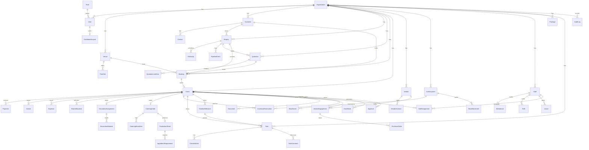

# Database Schema & ER Diagram

Canonical source: [`prisma/schema.prisma`](../prisma/schema.prisma). This document explains the model, the ER diagram, and the raw-SQL guarantees Prisma cannot express (exclusion constraints, RLS).

## 1. Principles
- **PostgreSQL** via Supabase. **Prisma** as ORM/migration tool.
- **Multi-tenant**: every business table has `orgId`. No cross-tenant foreign keys.
- **Money** stored as `Decimal(12,2)` (never floats). Currency at org level.
- **Soft references** for polymorphic links (e.g. `inventoryItemId` on BOM rows) kept nullable to allow ad-hoc items.
- **Enums** for finite state machines (stages, statuses) — enforced at DB level.
- **Timestamps** `createdAt` / `updatedAt` on mutable records; append-only tables (`AuditLog`, `PipelineEvent`, `StockMovement`) keep only `createdAt`.

## 2. ER Diagram



## 3. Key relationships & lifecycle

**Enquiry → Quotation → Booking → Event** is the spine:
- An `Enquiry` may produce many `Quotation` versions.
- Accepting a quotation creates one `Booking` (`enquiryId` and `quotationId` are `@unique` on Booking, enforcing 1:1 conversion).
- Confirming a booking opens exactly one `Event` (`bookingId @unique`) — the Workspace root.
- Everything operational hangs off `Event`.

## 4. Guarantees requiring raw SQL (post-Prisma migration)

### 4.1 Double-booking prevention (exclusion constraint)
Prisma can't express range exclusion. Add via a migration:

```sql
CREATE EXTENSION IF NOT EXISTS btree_gist;

ALTER TABLE "Booking"
  ADD CONSTRAINT booking_no_overlap
  EXCLUDE USING gist (
    "venueId" WITH =,
    tstzrange("startAt", "endAt") WITH &&
  )
  WHERE (status IN ('TENTATIVE', 'CONFIRMED'));
```
This makes overlapping active bookings for the same venue impossible at the storage layer — the API check is a UX nicety, this is the guarantee.

### 4.2 Row-Level Security (tenant isolation)
Every tenant table gets RLS keyed on the JWT `org_id` claim set by Supabase Auth:

```sql
ALTER TABLE "Event" ENABLE ROW LEVEL SECURITY;

CREATE POLICY tenant_isolation ON "Event"
  USING ("orgId" = current_setting('request.jwt.claims', true)::json->>'org_id');
```
Applied uniformly across all `orgId`-bearing tables via a generated migration loop.

### 4.3 Defense in depth
1. **RLS** (above) — last line, DB-enforced.
2. **Prisma middleware** — injects `orgId` filter on every query and `orgId` value on every create.
3. **API guard** — resolves org from session, rejects mismatches before handlers run.

## 5. Indexing strategy
- Tenant scoping: composite `(orgId, <hot filter>)` indexes on high-traffic tables (`Enquiry(orgId,stage)`, `Task(orgId,department,status)`, `Booking(orgId,status)`).
- Availability lookups: `Booking(venueId,startAt,endAt)`.
- Notification unread counts: `Notification(orgId,userId,readAt)`.
- Audit queries: `AuditLog(orgId,resource,resourceId)` and `(orgId,createdAt)`.

## 6. Migrations & seed
- `prisma migrate dev` for local, `prisma migrate deploy` in CI/CD.
- Raw-SQL guarantees (§4) live in dedicated migration files after the generated ones.
- `prisma/seed.ts` provisions: demo org, system roles, sample venues, menu/decoration packages, and one worked example event for QA.

## 7. Backups
- Supabase **PITR** (point-in-time recovery) on prod.
- Nightly `pg_dump` logical backup to object storage, 30-day retention, restore drill monthly (see [`DEPLOYMENT.md`](DEPLOYMENT.md)).
