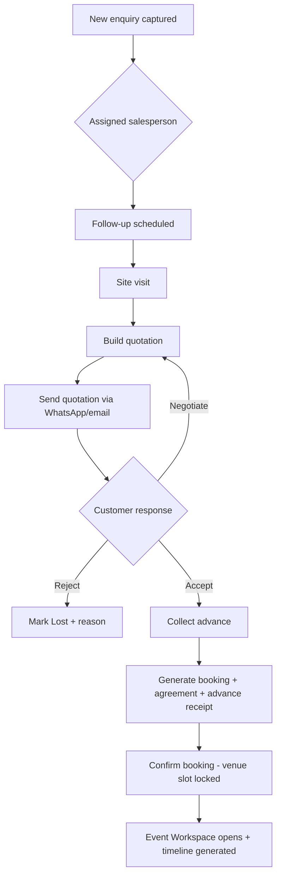
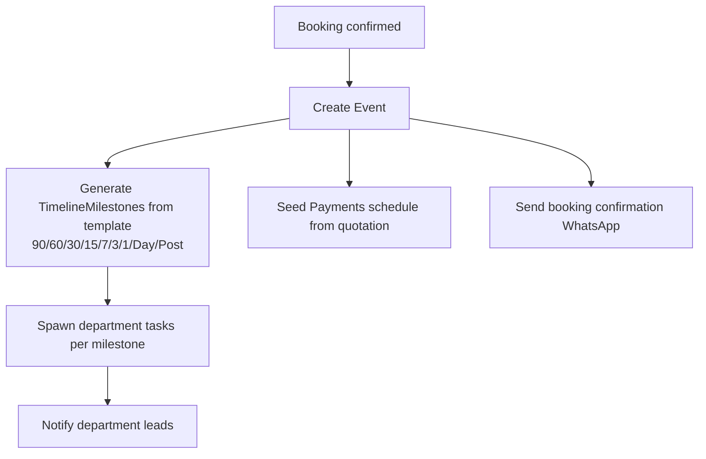
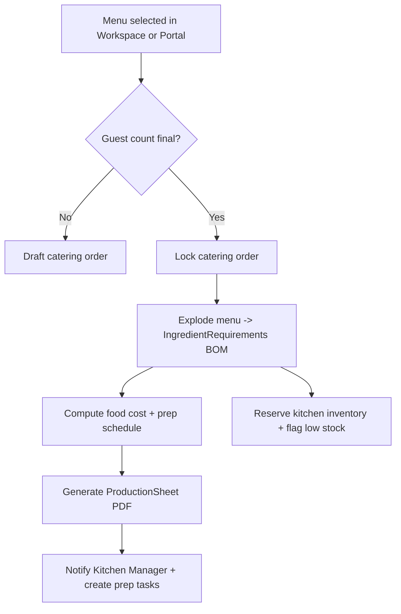
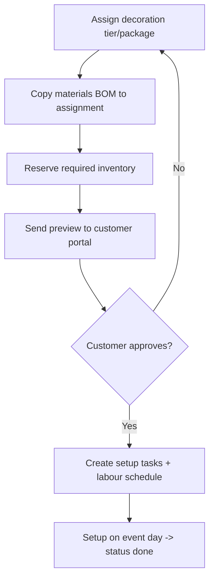
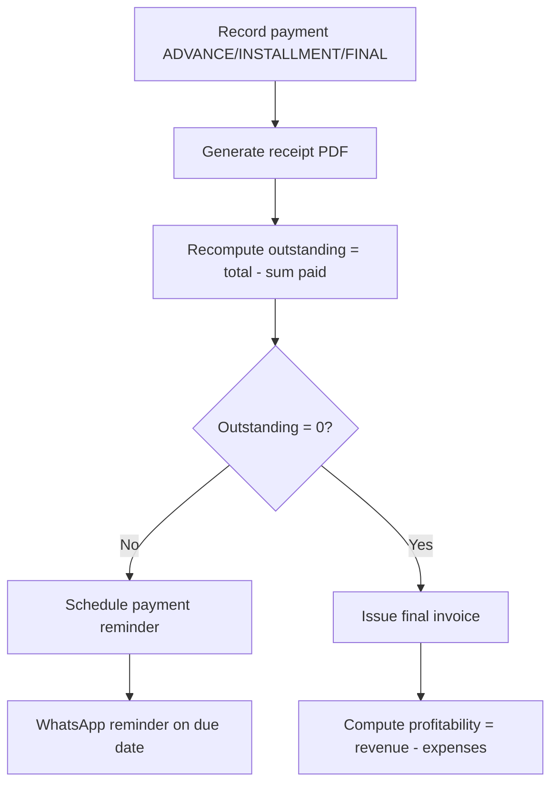
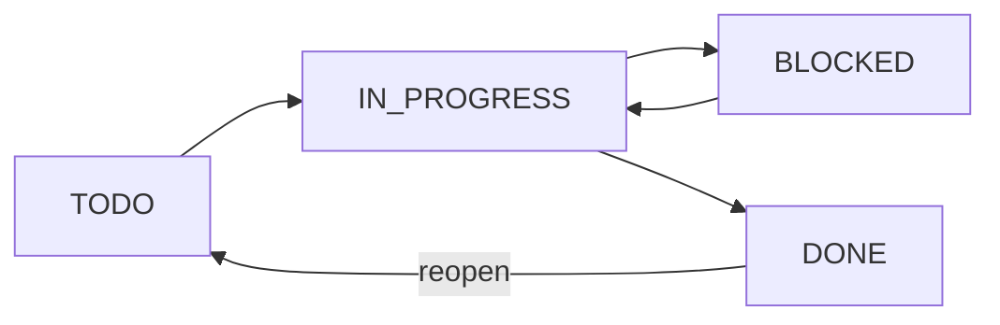
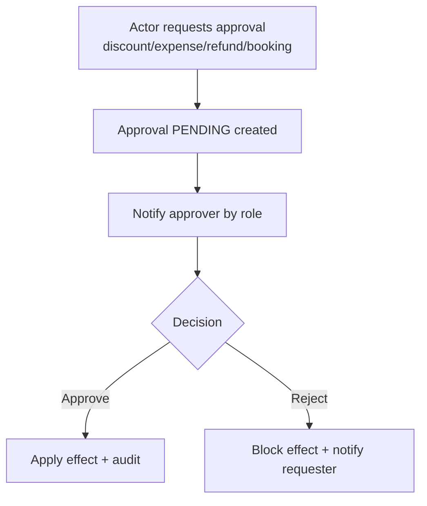
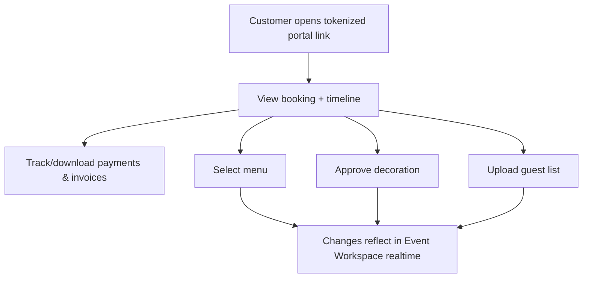
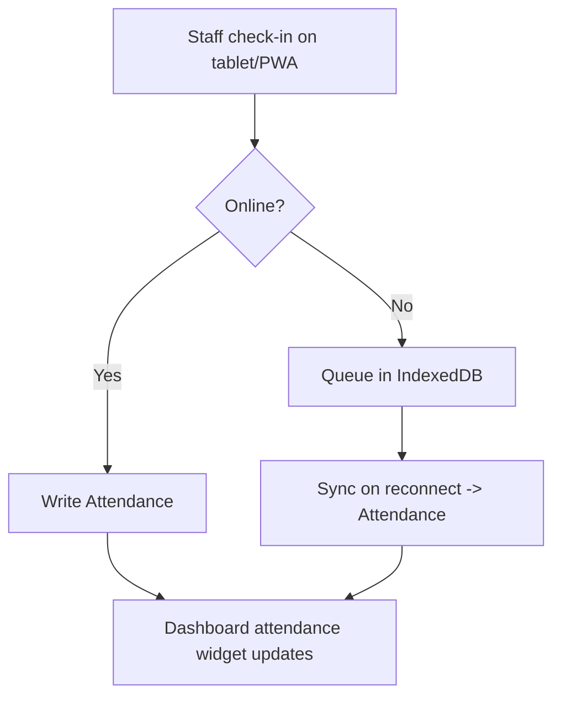

# User Flows

Flows use Mermaid. They cover the load-bearing journeys; secondary CRUD is standard list→form→save.

## 1. Enquiry → Confirmed booking (sales spine)



Key rules: stage transitions write `PipelineEvent`; `firstResponseAt` captured on first outbound touch for response-time metrics; accepting a quotation is the only path that seeds a `Booking`.

## 2. Booking confirmation → Event Workspace bootstrap



## 3. Catering: menu lock → kitchen production sheet



## 4. Decoration: assign package → setup



## 5. Finance: payment → outstanding → invoice



Discounts beyond a threshold and expenses over a limit route through **Approvals** before taking effect.

## 6. Task lifecycle (any department)


Checklist completion can gate `DONE`; completing all tasks in a milestone advances the milestone.

## 7. Approval flow



## 8. Customer portal self-service



## 9. Attendance (offline-capable)



## 10. AI-assisted quotation (human-in-the-loop)

```mermaid
flowchart TD
  A[Open quotation for enquiry] --> B[Click "AI draft"]
  B --> C[Server AI service reads enquiry + historical wins]
  C --> D[Returns suggested line items + pricing + margin]
  D --> E[Salesperson edits/accepts]
  E --> F[Save quotation version]
```
